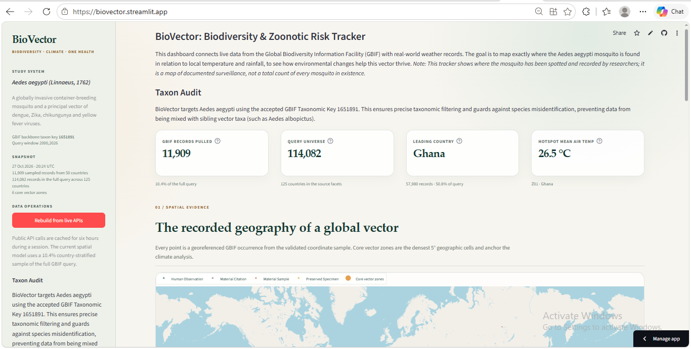

# BioVector: Quantitative Biodiversity Informatics & Zoonotic Niche Modeler

[](https://biovector.streamlit.app/)


---

## Live Application & Preview

Access the live cloud deployment here:
🔗 **[Launch BioVector Dashboard](https://biovector.streamlit.app/)**

<div align="center">
  
</div>

---

## 1. Project Title & Overview

### BioVector: Bridging Global Occurrence Informatics and Macroecological Climate Dynamics

**BioVector** is an interactive, quantitative biodiversity informatics platform and One Health macroecological dashboard that models the global distribution, sampling patterns, and climate niche of *Aedes aegypti* (Linnaeus, 1762)—the principal mosquito vector of dengue, Zika, chikungunya, and yellow fever arboviruses.

Modern public health and vector surveillance systems often struggle to bridge the gap between raw, presence-only biodiversity occurrences and localized meteorological realities. BioVector bridges this gap using a dual-API ingestion engine that pairs the **Global Biodiversity Information Facility (GBIF) Occurrence API** with reanalysis climate data from the **Open-Meteo Historical Weather API**. Rather than treating raw presence points as unbiased proxies for biological abundance, BioVector distinguishes between sampling effort, recording precision (day- and month-level versus year-only), and true ecological signals.

The platform provides epidemiological intelligence, spatial density clustering, and non-parametric seasonal rank correlations, allowing public health researchers, entomologists, and biosecurity analysts to examine where vector surveillance concentrates, how observation seasonality matches local precipitation and thermal rhythms, and where surveillance gaps remain.

---

## 2. Core Project Aims

- **Integrate Authoritative Global Biodiversity & Reanalysis Data:** Automatically query the GBIF Occurrence API and Open-Meteo Historical Weather Archive without reliance on synthetic or simulated records.
- **Enforce Taxonomic Integrity via Automated Auditing:** Audit and correct taxon identifiers programmatically. BioVector targets *Aedes aegypti* using accepted GBIF backbone taxon key `1651891`. This ensures precise taxonomic filtering and guards against species misidentification, preventing data from being mixed with sibling vector taxa (such as *Aedes albopictus*).
- **Stratify Spatial Sampling without Distortion:** Extract complete-query country and basis-of-record facets across >114,000 global records, while drawing a balanced country-stratified coordinate sample (~11,900 records across 50 countries) to prevent hyper-sampled jurisdictions from blinding global models.
- **Preserve Temporal Precision Rigorously:** Distinguish between day/month-resolved observation dates and year-only historical records. Year-only records remain on spatial GIS maps but are excluded from monthly seasonality profiles to prevent artificial temporal clustering.
- **Model Microclimate Niche Envelopes:** Cluster occurrence coordinates into 5.0° geographic core vector zones, compute centroid coordinates, and retrieve 12 complete calendar months of daily mean 2-meter air temperature and precipitation totals from ERA5 reanalysis.
- **Quantify Phenology–Climate Coupling:** Calculate Spearman rank correlations ($\rho$) and circular seasonal lags between monthly reporting intensities and local meteorological peaks to evaluate cross-scale surveillance coupling.
- **Deliver Reproducible, Provenance-Rich Science:** Persist structured CSV tables, complete metadata with API timestamps, row counts, and schema signatures, and provide one-click rebuild workflows from live endpoints.

---

## 3. Key Features & Takeaways

### What You Can Do with the Dashboard

- **Explore the Global Occurrence GIS Map:** Inspect 11,909 georeferenced records rendered on an interactive OpenStreetMap surface, color-coded by basis of record (**Human Observation**, **Material Citation**, **Preserved Specimen**, **Material Sample**), with overlay markers for high-density core vector zones.
- **Evaluate Surveillance Bias and Country Density:** Analyze complete GBIF query facets (114,082 records across 125 countries) versus sampled records, identifying surveillance hubs such as Ghana (which represents 50.8% of the global query) and the United States.
- **Track Seasonal Observation Curves:** View the empirical monthly reporting curve ($n = 4,930$ month-dated records), isolating the July–August global surveillance peak and identifying seasonal reporting dips.
- **Inspect Core-Zone Climate Rhythms:** Select any of the 6 identified core vector zones (Ghana, Chinese Taipei, Mexico, USA Florida, USA California, Ghana Western) to view 12-month dual-axis reanalysis climate charts displaying monthly precipitation sums and mean air temperatures.
- **Analyze the Climate Niche Envelope:** Examine an interactive bivariate scatter bubble plot comparing core vector zones across annual rainfall (mm) and annual mean air temperature (°C), with bubble radii scaled by occurrence sample density.
- **Evaluate Phenology–Climate Coupling:** Review automated Spearman rank correlations ($\rho_{\text{rain}}$ and $\rho_{\text{temp}}$) and circular lag statistics that compare the timing of peak surveillance with local meteorological highs.
- **Rebuild from Live APIs On-Demand:** Trigger a live pipeline refresh directly from the sidebar. The app queries GBIF and Open-Meteo, updates local CSVs, refreshes cache keys, and updates metadata with zero application downtime.
- **Download Reproducible Research Datasets:** Export cleaned sampled occurrences (CSV), complete country totals (CSV), and machine-readable metadata provenance (JSON) directly from the interface.

---

### Quick Guide to Analytical Controls & Indicators

| Component / Metric | What It Represents | How to Interpret It |
|---|---|---|
| **Core Vector Zone Selector** | Dropdown filtering the environmental analysis to a specific 5.0° cluster | Updates both the monthly climate rhythm chart and the seasonal coupling metrics. |
| **Complete Query Universe** | 114,082 records retrieved across 125 countries | The true unconstrained GBIF presence total for *A. aegypti* (2000–present, georeferenced). |
| **Sampled Occurrences** | 11,909 validated, coordinate-cleaned records | Country-stratified representation ensuring range-edge countries are not drowned out by top contributors. |
| **Month-Dated Sample** | 4,930 records with verified day- or month-level precision | The subset eligible for seasonality and phenological coupling (41.4% of sample). |
| **Spearman $\rho_{\text{rain}}$ & $\rho_{\text{temp}}$** | Rank correlation between 12-month observation share and climate variables | $+1.0$ indicates perfect seasonal synchronization; negative values indicate counter-cyclical reporting. |
| **Circular Lag** | Lead/lag in months between peak reporting and peak climate variable | Calculated via modular arithmetic on a 12-month circle: `((peak_obs - peak_clim + 6) % 12) - 6`. |
| **Basis of Record** | Methodological provenance of GBIF occurrences | Categorizes records into Human Observations (71.2%), Material Citations (14.9%), Preserved Specimens (10.8%), and Material Samples (3.2%). |

---

### The Analytical Framework at a Glance

#### 1. Spatial Grid Density Clustering
The pipeline aggregates occurrences into discrete spatial grid cells of $\Delta^\circ = 5.0^\circ$ latitude by longitude:

$$\text{cell}_{lat} = \lfloor \frac{\text{lat} + 90}{\Delta^\circ} \rfloor, \quad \text{cell}_{lon} = \lfloor \frac{\text{lon} + 180}{\Delta^\circ} \rfloor$$

Centroids of the top $K=6$ cells define the core vector zones:

$$\bar{\text{lat}}_z = \frac{1}{N_z} \sum_{i=1}^{N_z} \text{lat}_i, \quad \bar{\text{lon}}_z = \frac{1}{N_z} \sum_{i=1}^{N_z} \text{lon}_i$$

#### 2. Phenological Coupling & Circular Lag
Observation counts by month ($O_m$, $m \in [1, 12]$) and meteorological means ($C_m$, $m \in [1, 12]$) are evaluated using Spearman's rank correlation coefficient:

$$\rho = 1 - \frac{6 \sum_{m=1}^{12} d_m^2}{12(12^2 - 1)}, \quad \text{where } d_m = \text{rank}(O_m) - \text{rank}(C_m)$$

The circular timing lag between peak observation month ($m_O^*$) and peak climate month ($m_C^*$) is computed as:

$$\Delta m_{\text{circular}} = ((m_O^* - m_C^* + 6) \pmod{12}) - 6$$

A positive lag indicates that peak reporting follows peak rainfall/temperature; a zero lag indicates exact seasonal synchrony.

---

### Core Vector Zones Identified

| Zone ID | Zone Label | Dominant Country | Centroid Coordinates | Sample Occurrences | Sample Share | Mean Temp (°C) | Annual Rainfall (mm) |
|---|---|---|---|---|---|---|---|
| **Z01** | Z01 · Ghana | Ghana | 5.73° N, -0.22° E | 4,863 | 40.83% | 26.5 °C | 1,212 mm |
| **Z02** | Z02 · Chinese Taipei | Chinese Taipei | 22.64° N, 120.34° E | 907 | 7.62% | 25.8 °C | 2,130 mm |
| **Z03** | Z03 · Mexico | Mexico | 21.09° N, -98.46° W | 836 | 7.02% | 23.4 °C | 1,489 mm |
| **Z04** | Z04 · United States | USA (Florida) | 27.59° N, -81.21° W | 490 | 4.11% | 24.1 °C | 1,327 mm |
| **Z05** | Z05 · United States | USA (California) | 33.66° N, -117.63° W | 391 | 3.28% | 18.2 °C | 384 mm |
| **Z06** | Z06 · Ghana | Ghana (Western) | 4.90° N, -1.76° E | 299 | 2.51% | 26.8 °C | 1,605 mm |

---

### What the Evidence Teaches Us

- **Surveillance Effort Does Not Equal True Abundance:** Presence-only records reflect academic projects, municipal mosquito control programs, and infrastructure accessibility. Ghana's massive record volume stems from concentrated institutional surveillance campaigns, not necessarily a 10-fold higher vector population than neighboring nations.
- **Date Precision Is Essential for Phenology:** Over 58% of global GBIF occurrences for this vector carry year-only date stamps. Conflating year-only records with specific calendar months would distort ecological seasonality models.
- **Cross-Scale Mismatches Are Surveillance Signals:** At the primary Ghanaian vector hotspot, peak occurrence reporting occurs in July, while the local reanalysis rainfall peak occurs in June (a 1-month biological lag typical of mosquito breeding pool accumulation).
- **Taxonomic Diligence Is Critical in Automated Pipelines:** Automated pipelines that ingest biodiversity records require precise taxonomic validation. Validating *Aedes aegypti* (accepted GBIF key 1651891) prevents data from being mixed with sibling vector taxa (such as *Aedes albopictus*) and is fundamental to sound public health conclusions.

> **Important:** BioVector is an **analytical and exploratory macroecological platform**, not a clinical diagnostic or local spray-targeting tool. Presence-only data should not be interpreted as absence in unrecorded areas.

---

## 4. Project Architecture & File Structure

BioVector is designed with a modular architecture separating data ingestion and normalization from presentation and visualization.

```text
BioVector/
├── .gitignore                     # Git ignore rules for virtual environments, caches & logs
├── README.md                      # Comprehensive project documentation
├── app.py                         # Streamlit dashboard, visual styling & interactive charts
├── biovector-dashboard.png        # Architecture preview & dashboard banner screenshot
├── ingest.py                      # Dual-API pipeline, taxonomic resolver, spatial clustering & export
├── requirements.txt               # Pinned Python package dependencies (tested on Python 3.12)
└── data/
    ├── occurrences.csv            # Cleaned, country-stratified coordinate sample (11,909 rows)
    ├── country_totals.csv         # Complete GBIF query country-level facets (125 countries)
    ├── monthly_totals.csv         # Global seasonal observation totals (month-dated subset)
    ├── basis_totals.csv           # Global basis-of-record composition facets
    ├── core_zones.csv             # 5.0° geographic clusters, centroids, and sample counts
    ├── climate_monthly.csv        # 12-month reanalysis temperature & precipitation by zone
    ├── climate_daily.csv          # Daily reanalysis weather time series (ERA5/ERA5-Land)
    └── metadata.json              # Provenance manifest, timestamps, endpoints & taxonomic audit
```

### File Responsibilities

| File / Folder | Role in the System |
|---|---|
| **app.py** | Renders the responsive Streamlit user interface, customized styling tokens, KPI metrics, Scattermap GIS visualizations, dual-axis Plotly figures, and dynamic CSV/JSON export handlers. |
| **ingest.py** | Orchestrates resilient API querying, HTTP connection pooling with backoff retries, taxonomic name resolution, country-stratified sampling, 5.0° spatial clustering, Open-Meteo reanalysis retrieval, and metadata generation. |
| **biovector-dashboard.png** | Visual banner preview and architecture UI screenshot showcased in repository documentation. |
| **requirements.txt** | Explicitly pins exact tested library versions ensuring reproducible environments across Python 3.10–3.12. |
| **data/occurrences.csv** | Normalized occurrence records containing geographic coordinates, ISO country codes, event dates, precision classifications, and basis of record. |
| **data/country_totals.csv** | Unbiased query facets tracking total GBIF record volumes alongside sample representation across all 125 detected nations. |
| **data/monthly_totals.csv** | Clean monthly distribution of records possessing verified day- or month-level precision. |
| **data/core_zones.csv** | Geographic centroid specifications, dominant countries, and record densities for identified vector hotspots. |
| **data/climate_monthly.csv** | Aggregated monthly mean temperatures and cumulative precipitation sums across all core zones. |
| **data/climate_daily.csv** | Raw daily 2-meter air temperature and daily precipitation records underpinning monthly climate aggregates. |
| **data/metadata.json** | Complete audit trail documenting API endpoints, query parameters, taxonomic keys, execution timestamps, and data limitations. |

---

## 5. Tech Stack & Dependencies

| Technology | Category | Role in BioVector |
|---|---|---|
| **Streamlit (>=1.66, <2.0)** | Web Framework | Powers the interactive dashboard, responsive layout, sidebar controls, session state, and reactive caching. |
| **Pandas (>=2.2, <4.0)** | Data Engine | Ingests, normalizes, reshapes, merges, and validates multi-source tabular time series and facets. |
| **NumPy (>=1.26, <3.0)** | Numerical Math | Executes vector mathematics, grid-coordinate binning, and array-level operations. |
| **Plotly (>=5.24, <8.0)** | Visualization | Generates interactive OpenStreetMap scatter maps, dual-axis climographs, horizontal density bars, and bivariate bubble envelopes. |
| **Requests (>=2.31, <3.0)** | Networking | Manages resilient HTTP connections with custom retry adapters, timeouts, and header handling. |
| **Python (3.10+)** | Runtime | Modern Python runtime (tested on Python 3.12). |

### Integrated Public APIs

- **GBIF Occurrence & Species Match APIs:** ([api.gbif.org](https://api.gbif.org/v1))
  - Endpoint: `/v1/species/match` (taxonomic key resolution)
  - Endpoint: `/v1/occurrence/search` (multi-threaded occurrence queries and facet aggregation)
- **Open-Meteo Historical Weather / Reanalysis API:** ([archive-api.open-meteo.com](https://archive-api.open-meteo.com/v1/archive))
  - Daily parameters: `temperature_2m_mean`, `precipitation_sum`
  - Reanalysis models: ERA5 & ERA5-Land seamless global reanalysis

All dependencies are pinned in `requirements.txt` (tested and verified with Python 3.12):

| Package | Exact Tested Version | Compatible Version Range |
| :--- | :--- | :--- |
| **streamlit** | `1.66.0` | `>=1.66, <2.0` |
| **pandas** | `3.0.6` | `>=2.2, <4.0` |
| **numpy** | `2.5.4` | `>=1.26, <3.0` |
| **plotly** | `7.1.0` | `>=5.24, <8.0` |
| **requests** | `2.34.2` | `>=2.31, <3.0` |

```text
streamlit==1.66.0
pandas==3.0.6
numpy==2.5.4
plotly==7.1.0
requests==2.34.2
```

---

## 6. How to Set Up and Run the Project

### Prerequisites

- **Python 3.10 or newer** (Python 3.11 or 3.12 recommended)
- **Git**
- An active internet connection for initial API ingestion or live refresh (the repository bundles a pre-cached snapshot in `data/`, enabling offline dashboard execution immediately)

---

### Step 1: Clone the Repository

```bash
git clone https://github.com/ChijiokeUhegwu/BioVector.git
cd BioVector
```

---

### Step 2: Create and Activate a Virtual Environment

**Windows PowerShell**

```powershell
python -m venv .venv
.\.venv\Scripts\Activate.ps1
```

**macOS or Linux**

```bash
python3 -m venv .venv
source .venv/bin/activate
```

---

### Step 3: Install Dependencies

```bash
python -m pip install --upgrade pip
pip install -r requirements.txt
```

---

### Step 4: Refresh or Rebuild the Data (Optional)

The repository ships with an operational, validated data snapshot in `data/`. If you wish to pull fresh occurrence records from GBIF and re-query Open-Meteo reanalysis data, run the ingestion script:

```bash
python ingest.py
```

#### Advanced Ingestion CLI Options

```bash
# Pull up to 20,000 records across an expanded query
python ingest.py --max-records 20000

# Alter the starting query year (e.g., historical window from 2010 onwards)
python ingest.py --start-year 2010

# Adjust core zone clustering (e.g., 8 zones using 4.0-degree grid bins)
python ingest.py --zones 8 --grid 4.0

# Direct output to a custom directory
python ingest.py --output-dir ./custom_data
```

| Parameter | Type | Default | Description |
|---|---|---|---|
| `--max-records` | int (300 to 30,000) | `12,000` | Target cleaned record ceiling for coordinate sampling. |
| `--start-year` | int (1900 to present) | `2000` | Earliest collection year included in GBIF query. |
| `--zones` | int (1 to 12) | `6` | Number of core geographic cluster centroids to extract. |
| `--grid` | float (1.0 to 20.0) | `5.0` | Spatial grid cell size in decimal degrees for clustering. |
| `--output-dir` | Path | `data/` | Target folder for normalized CSVs and metadata. |

---

### Step 5: Start the Dashboard

Launch the Streamlit application from the project root:

```bash
streamlit run app.py
```

The application will initialize and open automatically in your browser at:

```text
http://localhost:8501
```

---

### Step 6: Explore the Dashboard

1. **Review Headline Indicators:** Check the total query universe (114,082 records), validated sampled points (11,909), leading reporting nation (Ghana), and hotspot mean air temperature.
2. **Interact with the Global Occurrence Map:** Pan and zoom across occurrence clusters. Hover over points to examine individual basis of record classifications and observation dates.
3. **Compare Reporting Density vs Seasonality:** Observe how Ghana, the US, and Mexico lead global observation volume, while global reporting exhibits a marked summer peak (July–August).
4. **Select a Core Vector Zone:** Use the dropdown in section `03 / Climate niche` to switch between Ghana (Z01), Taiwan (Z02), Mexico (Z03), Florida (Z04), California (Z05), or Western Ghana (Z06).
5. **Inspect the Climate Envelope:** Hover over bubbles in the climate envelope to compare temperature and precipitation regimes across all vector hotspots.
6. **Interpret Phenology Coupling:** Review section `04` to see whether reporting peaks align with local rainfall or thermal peaks, and assess the circular lag and Spearman correlation coefficients.
7. **Inspect Methods & Export Data:** Expand section `05` to review data lineage, taxonomic audits, and download occurrence, country, or metadata files.

---

### Troubleshooting

- **Port 8501 is already in use:** Run the dashboard on a designated secondary port:
  ```bash
  streamlit run app.py --server.port 8502
  ```
- **GBIF API Rate Limiting or Timeout:** If live rebuild encounters network latency, the pipeline automatically retries with exponential backoff (status codes 429, 500, 502, 503, 504). If the external API is unreachable, the app automatically falls back to the local `data/` snapshot.
- **PowerShell Execution Policy Error:** If script activation is restricted on Windows:
  ```powershell
  Set-ExecutionPolicy -ExecutionPolicy RemoteSigned -Scope Process
  .\.venv\Scripts\Activate.ps1
  ```
- **Missing Snapshot Files:** If files in `data/` are deleted, run `python ingest.py` from the root directory to regenerate the complete bundle.

---

## 7. Repository & Deployment Links

| Resource | URL |
|---|---|
| **GitHub Repository** | [https://github.com/ChijiokeUhegwu/BioVector](https://github.com/ChijiokeUhegwu/BioVector) |
| **Live Streamlit Dashboard** | [https://biovector.streamlit.app/](https://biovector.streamlit.app/) |

### Data Sources & Attribution

- **Global Biodiversity Information Facility (GBIF):**
  - Dataset: *Aedes aegypti* (Linnaeus, 1762) Occurrence Download
  - Query: Taxon Key `1651891`, `hasCoordinate=true`, `hasGeospatialIssue=false`, `occurrenceStatus=PRESENT`, `year=2000,2026`
  - Portal & API: [https://www.gbif.org](https://www.gbif.org) | [https://api.gbif.org/v1/occurrence/search](https://api.gbif.org/v1/occurrence/search)
- **Open-Meteo Historical Weather API:**
  - Data: ERA5 & ERA5-Land Reanalysis (ECMWF)
  - Parameters: 2 m mean daily temperature, daily precipitation sum
  - Portal & API: [https://open-meteo.com](https://open-meteo.com) | [https://archive-api.open-meteo.com/v1/archive](https://archive-api.open-meteo.com/v1/archive)

---

### Citation & Attribution

If you utilize BioVector in academic research, public health surveillance analysis, or macroecological teaching, please attribute the source as follows:

```bibtex
@software{uhegwu2026biovector,
  author       = {Uhegwu, Chijioke C.},
  title        = {BioVector: Quantitative Biodiversity Informatics & Zoonotic Niche Modeler},
  year         = {2026},
  publisher    = {GitHub},
  journal      = {GitHub repository},
  howpublished = {\url{https://github.com/ChijiokeUhegwu/BioVector}}
}
```

---

**BioVector** is an analytical informatics and scenario-modeling platform developed by **Chijioke C. Uhegwu**. It supports quantitative exploration, vector surveillance analysis, and macroecological education; it does not replace official epidemiological surveillance, field entomology, or localized clinical guidance. All rights reserved.
